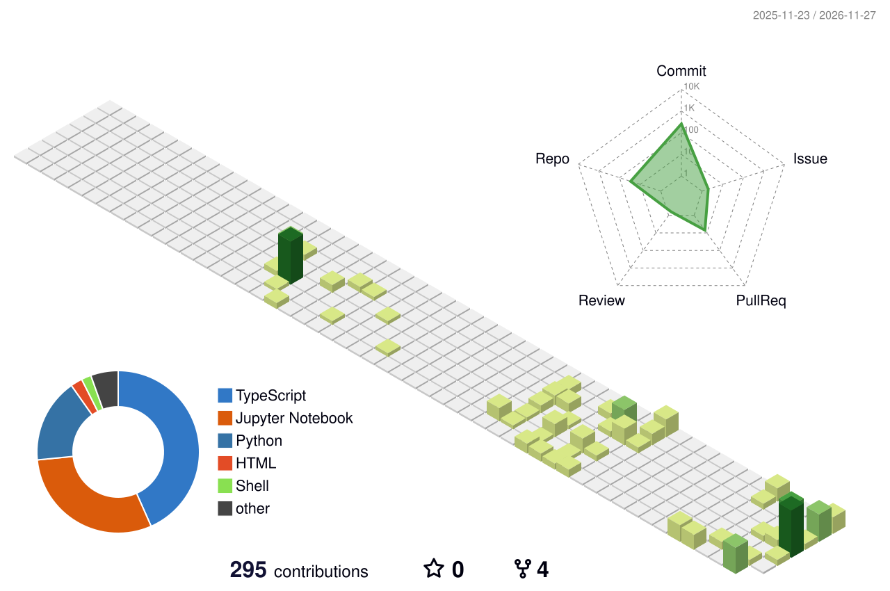

<!-- Top Multi-Tone Accent Rule -->

 

<h1>Muhammad Ali</h1>

<!-- Animated Gradient Motion Tagline -->

  

<!-- Primary Contact Badges with Official Brand Colors -->

  
  &nbsp;
  
  &nbsp;
  
  &nbsp;
  

<!-- Profile Metrics & Live Demo Badges -->

  
  
  
  
  

<!-- Section Navigation -->

  <a href="#architecture--specialization">Specialization</a> &nbsp;&middot;&nbsp;
  <a href="#technical-ecosystem">Tech Ecosystem</a> &nbsp;&middot;&nbsp;
  <a href="#engineering-analytics--telemetry">Analytics</a> &nbsp;&middot;&nbsp;
  <a href="#contribution-pathway">Contribution Snake</a> &nbsp;&middot;&nbsp;
  <a href="#3d-contribution-skyline">3D Skyline</a>

---

## 🏛️ Architecture & Specialization

<table>
  <tr>
    <td width="50%" valign="top">
      
      <h3>🤖 Agentic AI &amp; Intelligent Automation</h3>
      

        Architecting stateful, resilient multi-agent systems using <strong>LangGraph</strong> with persistent checkpointer memory (SQLite &amp; PostgreSQL), Human-in-the-Loop (HITL) approval gates, and multi-provider LLM routing across Groq, OpenAI, Anthropic, and Gemini. Comprehensive execution observability and evaluation configured with <strong>LangSmith</strong>.
      

      

        Engineering modular <strong>FastMCP</strong> tool servers integrated via <code>langchain-mcp-adapters</code> with resilient primary and fallback routing. Deploying production-grade Corrective RAG (<strong>CRAG</strong>) and <strong>Self-RAG</strong> pipelines with <strong>ChromaDB</strong> and <strong>FAISS</strong>, orchestrated alongside automated, event-driven background workflows built in <strong>n8n</strong>.
      

    </td>
    <td width="50%" valign="top">
      
      <h3>🌐 Web Applications (Next.js &amp; MERN)</h3>
      

        Engineering high-performance, responsive web interfaces with <strong>Next.js 15</strong> (App Router, Server Actions), <strong>React 19</strong>, and <strong>TypeScript</strong>, styled with utility-first <strong>Tailwind CSS</strong>. Architected for optimal Core Web Vitals, seamless accessibility, and clean component-driven design systems.
      

      

        Developing full-stack MERN solutions across <strong>MongoDB</strong>, <strong>Express.js</strong>, <strong>React</strong>, and <strong>Node.js</strong>. Building high-throughput asynchronous backend microservices in <strong>FastAPI</strong> with bidirectional <strong>WebSockets</strong> for real-time AI token streaming, low-latency client communication, and structured RESTful APIs.
      

    </td>
  </tr>
  <tr>
    <td width="50%" valign="top">
      
      <h3>📱 Mobile Engineering (Flutter &amp; Dart)</h3>
      

        Crafting cross-platform native mobile applications in <strong>Flutter</strong> &amp; <strong>Dart</strong> for Android and iOS, featuring fluid 60fps animations, adaptive screen layouts, and robust reactive state management. Designed for intuitive user experiences, native responsiveness, and high device compatibility.
      

      

        Implementing zero-trust client security models with <strong>Firebase Authentication</strong>, real-time data persistence via <strong>Cloud Firestore</strong>, and serverless Cloud Functions. Engineered with offline-first local caching, background sync mechanisms, and resilient network failover handling.
      

    </td>
    <td width="50%" valign="top">
      
      <h3>☁️ Cloud Systems &amp; Database Architecture</h3>
      

        Designing scalable cloud infrastructure and serverless deployments across <strong>AWS</strong>, <strong>Firebase</strong>, <strong>Vercel</strong>, and <strong>Render</strong>. Optimizing containerized microservice deployments with <strong>Docker</strong>, production Linux environments, and automated CI/CD continuous integration pipelines using <strong>GitHub Actions</strong>.
      

      

        Structuring enterprise relational and document persistence using <strong>PostgreSQL</strong>, <strong>SQLite</strong> (agent checkpoints and conversation memory), and <strong>MongoDB</strong>. Implementing efficient schema indexing, connection pooling, automated database backups, and strict data-layer security policies.
      

    </td>
  </tr>
</table>

---

## 🛠️ Technical Ecosystem

<table>
  <thead>
    <tr>
      <th align="left" width="24%">Domain</th>
      <th align="left">Verified Technologies &amp; Frameworks</th>
    </tr>
  </thead>
  <tbody>
    <tr>
      <td><strong>Core Languages</strong></td>
      <td>
        
        
        
        
        
        
        
      </td>
    </tr>
    <tr>
      <td><strong>Agentic AI &amp; LLMs</strong></td>
      <td>
        
        
        
        
        
        
        
        
        
        
      </td>
    </tr>
    <tr>
      <td><strong>RAG &amp; Retrieval</strong></td>
      <td>
        
        
        
        
        
        
        
      </td>
    </tr>
    <tr>
      <td><strong>Frontend Systems</strong></td>
      <td>
        
        
        
        
        
        
      </td>
    </tr>
    <tr>
      <td><strong>Backend &amp; APIs</strong></td>
      <td>
        
        
        
        
      </td>
    </tr>
    <tr>
      <td><strong>Mobile Applications</strong></td>
      <td>
        
        
        
        
      </td>
    </tr>
    <tr>
      <td><strong>Cloud &amp; Databases</strong></td>
      <td>
        
        
        
        
      </td>
    </tr>
    <tr>
      <td><strong>DevOps, Tools &amp; Automation</strong></td>
      <td>
        
        
        
        
        
        
        
        
        
      </td>
    </tr>
  </tbody>
</table>

---

## 📊 Engineering Analytics & Telemetry

<table>
  <tr>
    <td align="center" width="52%" valign="middle">
      <picture>
        <source media="(prefers-color-scheme: dark)" srcset="https://github-readme-stats.vercel.app/api?username=muhammadali382&show_icons=true&hide_rank=true&title_color=10B981&icon_color=10B981&text_color=E2E8F0&bg_color=0D1117&border_color=30363D&border_radius=8&cache_seconds=1800">
        <source media="(prefers-color-scheme: light)" srcset="https://github-readme-stats.vercel.app/api?username=muhammadali382&show_icons=true&hide_rank=true&title_color=059669&icon_color=059669&text_color=334155&bg_color=FFFFFF&border_color=E2E8F0&border_radius=8&cache_seconds=1800">
        
      </picture>
    </td>
    <td align="center" width="48%" valign="middle">
      <picture>
        <source media="(prefers-color-scheme: dark)" srcset="https://github-readme-stats.vercel.app/api/top-langs/?username=muhammadali382&layout=compact&langs_count=8&title_color=10B981&text_color=E2E8F0&bg_color=0D1117&border_color=30363D&border_radius=8&cache_seconds=1800">
        <source media="(prefers-color-scheme: light)" srcset="https://github-readme-stats.vercel.app/api/top-langs/?username=muhammadali382&layout=compact&langs_count=8&title_color=059669&text_color=334155&bg_color=FFFFFF&border_color=E2E8F0&border_radius=8&cache_seconds=1800">
        
      </picture>
    </td>
  </tr>
</table>

 

<picture>
  <source media="(prefers-color-scheme: dark)" srcset="https://streak-stats.demolab.com/?user=muhammadali382&background=0D1117&border=30363D&stroke=30363D&ring=10B981&fire=F59E0B&currStreakNum=10B981&sideNums=F0F6FC&currStreakLabel=8B949E&sideLabels=8B949E&dates=6E7681&border_radius=8">
  <source media="(prefers-color-scheme: light)" srcset="https://streak-stats.demolab.com/?user=muhammadali382&background=FFFFFF&border=E2E8F0&stroke=E2E8F0&ring=10B981&fire=F59E0B&currStreakNum=10B981&sideNums=0F172A&currStreakLabel=475569&sideLabels=475569&dates=64748B&border_radius=8">
  
</picture>

  

<picture>
  <source media="(prefers-color-scheme: dark)" srcset="https://github-readme-activity-graph.vercel.app/graph?username=muhammadali382&bg_color=0D1117&color=F0F6FC&line=10B981&point=10B981&area=true&area_color=064E3B&hide_border=true&custom_title=Engineering%20Contribution%20Activity">
  <source media="(prefers-color-scheme: light)" srcset="https://github-readme-activity-graph.vercel.app/graph?username=muhammadali382&bg_color=FFFFFF&color=0F172A&line=10B981&point=10B981&area=true&area_color=D1FAE5&hide_border=true&custom_title=Engineering%20Contribution%20Activity">
  
</picture>

---

## 🐍 Contribution Pathway

  <picture>
    <source media="(prefers-color-scheme: dark)" srcset="https://raw.githubusercontent.com/muhammadali382/muhammadali382/output/github-snake-dark.svg" />
    <source media="(prefers-color-scheme: light)" srcset="https://raw.githubusercontent.com/muhammadali382/muhammadali382/output/github-snake.svg" />
    
  </picture>

---

## 🏙️ 3D Contribution Skyline

  <picture>
    <source media="(prefers-color-scheme: dark)" srcset="https://raw.githubusercontent.com/muhammadali382/muhammadali382/main/profile-3d-contrib/profile-night-rainbow.svg" />
    <source media="(prefers-color-scheme: light)" srcset="https://raw.githubusercontent.com/muhammadali382/muhammadali382/main/profile-3d-contrib/profile-green-animate.svg" />
    
  </picture>

---

  Architected with precision &bull; <a href="https://github.com/muhammadali382">Muhammad Ali</a> &bull; Lahore, Pakistan

