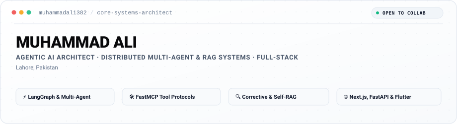

  <picture>
    <source media="(prefers-color-scheme: dark)" srcset="https://raw.githubusercontent.com/muhammadali382/muhammadali382/main/assets/banner-dark.svg">
    <source media="(prefers-color-scheme: light)" srcset="https://raw.githubusercontent.com/muhammadali382/muhammadali382/main/assets/banner-light.svg">
    
  </picture>

  
  &nbsp;
  
  &nbsp;
  
  &nbsp;
  

  
  &nbsp;
  
  &nbsp;
  

---

## 🏛️ Architecture & Specialization

<table>
  <tr>
    <td width="50%" valign="top">
      <h3>🤖 Autonomous Agents &amp; Tool Orchestration</h3>
      

        Architecting resilient, stateful multi-agent workflows using <strong>LangGraph</strong> with checkpointed memory, Human-in-the-Loop (HITL) approval gates, and multi-provider LLM routing (Groq, OpenAI, Anthropic, Gemini). Full execution observability and evaluation with <strong>LangSmith</strong>.
      

    </td>
    <td width="50%" valign="top">
      <h3>🔌 Model Context Protocol (FastMCP)</h3>
      

        Building modular remote and local <strong>FastMCP</strong> tool servers integrated via <code>langchain-mcp-adapters</code>. Designed with primary and fallback routing across live search, algorithmic math, weather telemetry, and secure system knowledge retrieval.
      

    </td>
  </tr>
  <tr>
    <td width="50%" valign="top">
      <h3>🔍 Knowledge Retrieval &amp; Semantic RAG</h3>
      

        Implementing production-grade <strong>Corrective RAG (CRAG)</strong> and <strong>Self-RAG</strong> pipelines. Hybrid dense/sparse vector retrieval with <strong>ChromaDB</strong>, <strong>FAISS</strong>, and <strong>Sentence-Transformers</strong> (<code>all-MiniLM-L6-v2</code>) with thread-isolated document context.
      

    </td>
    <td width="50%" valign="top">
      <h3>🌐 Full-Stack Web, Mobile &amp; Cloud Systems</h3>
      

        High-performance web applications built on <strong>Next.js 15</strong>, <strong>React 19</strong>, <strong>TypeScript</strong>, and <strong>Tailwind CSS</strong>, connected to async <strong>FastAPI</strong> backends over WebSockets. Mobile applications built with <strong>Flutter</strong> &amp; <strong>Firebase</strong>.
      

    </td>
  </tr>
</table>

---

## 🛠️ Technical Ecosystem

  <picture>
    <source media="(prefers-color-scheme: dark)" srcset="https://skillicons.dev/icons?i=py,ts,js,dart,html,css,react,nextjs,tailwind,bootstrap,vite,flutter,firebase,fastapi,nodejs,express,mongodb,postgres,sqlite,pytorch,docker,githubactions,git,linux,vscode,vercel&perline=13&theme=dark" />
    <source media="(prefers-color-scheme: light)" srcset="https://skillicons.dev/icons?i=py,ts,js,dart,html,css,react,nextjs,tailwind,bootstrap,vite,flutter,firebase,fastapi,nodejs,express,mongodb,postgres,sqlite,pytorch,docker,githubactions,git,linux,vscode,vercel&perline=13&theme=light" />
    
  </picture>

<table>
  <thead>
    <tr>
      <th align="left" width="26%">Domain</th>
      <th align="left">Technologies &amp; Frameworks</th>
    </tr>
  </thead>
  <tbody>
    <tr>
      <td><strong>Core Languages</strong></td>
      <td><code>Python</code> &bull; <code>TypeScript</code> &bull; <code>JavaScript</code> &bull; <code>Dart</code> &bull; <code>SQL</code> &bull; <code>HTML5</code> &bull; <code>CSS3</code></td>
    </tr>
    <tr>
      <td><strong>Agentic AI &amp; LLMs</strong></td>
      <td><code>LangGraph</code> &bull; <code>LangChain</code> &bull; <code>LangSmith</code> &bull; <code>FastMCP</code> &bull; <code>Groq</code> &bull; <code>OpenAI</code> &bull; <code>Anthropic Claude</code> &bull; <code>Google Gemini</code> &bull; <code>Hugging Face</code> &bull; <code>Pydantic</code></td>
    </tr>
    <tr>
      <td><strong>RAG &amp; Vector Stores</strong></td>
      <td><code>ChromaDB</code> &bull; <code>FAISS</code> &bull; <code>Sentence-Transformers</code> &bull; <code>CRAG</code> &bull; <code>Self-RAG</code> &bull; <code>Tavily</code> &bull; <code>DuckDuckGo</code></td>
    </tr>
    <tr>
      <td><strong>Frontend Systems</strong></td>
      <td><code>Next.js 15</code> &bull; <code>React 19</code> &bull; <code>TypeScript</code> &bull; <code>Tailwind CSS</code> &bull; <code>Vite</code> &bull; <code>Bootstrap</code> &bull; <code>Streamlit</code></td>
    </tr>
    <tr>
      <td><strong>Backend &amp; Microservices</strong></td>
      <td><code>FastAPI</code> &bull; <code>WebSockets</code> &bull; <code>Node.js</code> &bull; <code>Express.js</code> &bull; <code>REST APIs</code></td>
    </tr>
    <tr>
      <td><strong>Mobile &amp; Cloud BaaS</strong></td>
      <td><code>Flutter</code> &bull; <code>Dart</code> &bull; <code>Firebase Auth</code> &bull; <code>Cloud Firestore</code> &bull; <code>Firebase Functions</code></td>
    </tr>
    <tr>
      <td><strong>Databases &amp; Persistence</strong></td>
      <td><code>PostgreSQL</code> &bull; <code>SQLite</code> &bull; <code>MongoDB</code></td>
    </tr>
    <tr>
      <td><strong>DevOps, Tools &amp; Automation</strong></td>
      <td><code>Docker</code> &bull; <code>Git</code> &bull; <code>GitHub Actions</code> &bull; <code>Linux / Bash</code> &bull; <code>n8n Workflows</code> &bull; <code>uv</code> &bull; <code>Jupyter</code> &bull; <code>Vercel</code> &bull; <code>Render</code></td>
    </tr>
  </tbody>
</table>

---

## 📊 Engineering Analytics & Telemetry

<table>
  <tr>
    <td align="center" width="52%" valign="middle">
      <picture>
        <source media="(prefers-color-scheme: dark)" srcset="https://github-readme-stats.vercel.app/api?username=muhammadali382&show_icons=true&hide_rank=true&title_color=FFFFFF&text_color=9CA3AF&icon_color=FFFFFF&bg_color=0D1117&border_color=30363D&border_radius=8&cache_seconds=1800">
        <source media="(prefers-color-scheme: light)" srcset="https://github-readme-stats.vercel.app/api?username=muhammadali382&show_icons=true&hide_rank=true&title_color=000000&text_color=4B5563&icon_color=000000&bg_color=FFFFFF&border_color=E5E7EB&border_radius=8&cache_seconds=1800">
        
      </picture>
    </td>
    <td align="center" width="48%" valign="middle">
      <picture>
        <source media="(prefers-color-scheme: dark)" srcset="https://github-readme-stats.vercel.app/api/top-langs/?username=muhammadali382&layout=compact&langs_count=8&title_color=FFFFFF&text_color=9CA3AF&bg_color=0D1117&border_color=30363D&border_radius=8&cache_seconds=1800">
        <source media="(prefers-color-scheme: light)" srcset="https://github-readme-stats.vercel.app/api/top-langs/?username=muhammadali382&layout=compact&langs_count=8&title_color=000000&text_color=4B5563&bg_color=FFFFFF&border_color=E5E7EB&border_radius=8&cache_seconds=1800">
        
      </picture>
    </td>
  </tr>
</table>

 

<picture>
  <source media="(prefers-color-scheme: dark)" srcset="https://streak-stats.demolab.com/?user=muhammadali382&background=0D1117&border=30363D&stroke=30363D&ring=FFFFFF&fire=FFFFFF&currStreakNum=FFFFFF&sideNums=FFFFFF&currStreakLabel=9CA3AF&sideLabels=9CA3AF&dates=6E7681&border_radius=8">
  <source media="(prefers-color-scheme: light)" srcset="https://streak-stats.demolab.com/?user=muhammadali382&background=FFFFFF&border=E5E7EB&stroke=E5E7EB&ring=000000&fire=000000&currStreakNum=000000&sideNums=000000&currStreakLabel=4B5563&sideLabels=4B5563&dates=6B7280&border_radius=8">
  
</picture>

  

<picture>
  <source media="(prefers-color-scheme: dark)" srcset="https://github-readme-activity-graph.vercel.app/graph?username=muhammadali382&bg_color=0D1117&color=FFFFFF&line=FFFFFF&point=FFFFFF&area=true&area_color=161B22&hide_border=true&custom_title=Engineering%20Contribution%20Activity">
  <source media="(prefers-color-scheme: light)" srcset="https://github-readme-activity-graph.vercel.app/graph?username=muhammadali382&bg_color=FFFFFF&color=000000&line=000000&point=000000&area=true&area_color=F4F4F5&hide_border=true&custom_title=Engineering%20Contribution%20Activity">
  
</picture>

---

## 🐍 Contribution Pathway

  <picture>
    <source media="(prefers-color-scheme: dark)" srcset="https://raw.githubusercontent.com/muhammadali382/muhammadali382/output/github-snake-dark.svg" />
    <source media="(prefers-color-scheme: light)" srcset="https://raw.githubusercontent.com/muhammadali382/muhammadali382/output/github-snake.svg" />
    
  </picture>

---

## 🏙️ 3D Contribution Skyline

  <picture>
    <source media="(prefers-color-scheme: dark)" srcset="https://raw.githubusercontent.com/muhammadali382/muhammadali382/main/profile-3d-contrib/profile-night-view.svg" />
    <source media="(prefers-color-scheme: light)" srcset="https://raw.githubusercontent.com/muhammadali382/muhammadali382/main/profile-3d-contrib/profile-green-animate.svg" />
    
  </picture>

---

  Architected with precision &bull; <a href="https://github.com/muhammadali382">Muhammad Ali</a> &bull; Lahore, Pakistan

