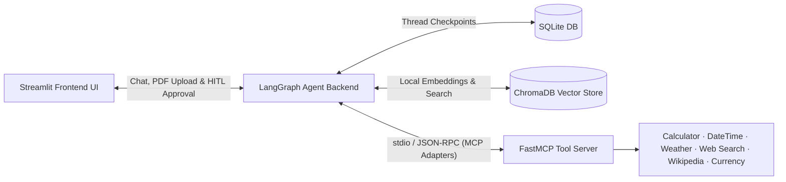

<!-- Top Light Accent Rule -->

 

<h1>Muhammad Ali</h1>

  <strong>Agentic AI Engineer &nbsp;&middot;&nbsp; Full-Stack Developer (Next.js / MERN) &nbsp;&middot;&nbsp; Flutter &amp; Automation Builder</strong>

<!-- Light-Theme Animated Typing Tagline -->

  Minhaj University Lahore (STCS) &nbsp;&middot;&nbsp; Lahore, Pakistan

 

<!-- Primary Contact & Live Portfolio Links -->

  
  
  
  

<!-- Profile Metrics Pills -->

  
  
  
  
  

<!-- Section Navigation -->

  <a href="#about">About</a> &nbsp;&middot;&nbsp;
  <a href="#technology-stack">Tech Stack</a> &nbsp;&middot;&nbsp;
  <a href="#featured-projects">Projects</a> &nbsp;&middot;&nbsp;
  <a href="#github-analytics">Analytics</a> &nbsp;&middot;&nbsp;
  <a href="#contribution-snake">Snake</a> &nbsp;&middot;&nbsp;
  <a href="#3d-contribution-skyline">3D Skyline</a> &nbsp;&middot;&nbsp;
  <a href="#connect">Connect</a>

---

## About

I am an **AI and Full-Stack Software Engineer** focused on building practical, production-oriented **Agentic AI systems**, **Retrieval-Augmented Generation (RAG)** workflows, **Model Context Protocol (MCP)** tool servers, and end-to-end **web and mobile applications**.

Across public open-source repositories, hackathons, IEEE security research, and private mobile builds, my engineering work spans from multi-agent orchestration and clinical triage tooling to zero-trust serverless backends.

<table>
  <tr>
    <td width="50%" valign="top">
      <strong>🤖 Agentic AI &amp; RAG Systems</strong> 
      Stateful <code>LangGraph</code> workflows, Human-in-the-Loop (HITL) tool approval, Corrective &amp; Self-RAG pipelines, short/long-term LLM memory (SQLite &amp; PostgreSQL), and <code>LangSmith</code> tracing.
    </td>
    <td width="50%" valign="top">
      <strong>🔌 MCP Servers &amp; Tool Infrastructure</strong> 
      Modular remote <code>FastMCP</code> servers integrated via <code>langchain-mcp-adapters</code> with resilient primary/fallback API routing across search, weather, math, and knowledge tools.
    </td>
  </tr>
  <tr>
    <td width="50%" valign="top">
      <strong>🌐 Full-Stack Web &amp; Mobile</strong> 
      Production web interfaces with <code>Next.js 15</code>, <code>React</code>, <code>TypeScript</code>, <code>Tailwind CSS</code>, and <code>FastAPI</code> + WebSockets, alongside zero-trust <code>Flutter</code> + <code>Firebase</code> mobile apps and MERN coursework.
    </td>
    <td width="50%" valign="top">
      <strong>🛡️ AI Security Research &amp; Automation</strong> 
      IEEE research framework analyzing multi-agent LLM security vulnerabilities across 9 threat gaps, paired with workflow automation engineering in <code>n8n</code> and Python.
    </td>
  </tr>
</table>

---

## Technology Stack

> Every technology below is verified from repository manifests, implemented codebases, or stated profile specializations. Usage scope is noted to clearly distinguish **project-implemented tools** from **documented coursework/bio focus**.

<table>
  <thead>
    <tr>
      <th align="left" width="22%">Category</th>
      <th align="left">Technologies &amp; Verified Usage</th>
    </tr>
  </thead>
  <tbody>
    <tr>
      <td><strong>Languages</strong></td>
      <td>
        
        
        
        
        
        
        
         <em>Project usage across AI backends, Next.js/React apps, Flutter mobile, and SQLite/PostgreSQL persistence.</em>
      </td>
    </tr>
    <tr>
      <td><strong>AI &amp; LLM Engineering</strong></td>
      <td>
        
        
        
        
        
        
        
        
        
        
         <em>Production &amp; lab usage in TabeebCare, Neural Debate, Groq Chatbot, Chatbot MCP Server, Jarvis Mini, and CampusX series.</em>
      </td>
    </tr>
    <tr>
      <td><strong>RAG &amp; Retrieval</strong></td>
      <td>
        
        
        
        
        
        
        
         <em>Implemented in thread-isolated PDF RAG (<code>all-MiniLM-L6-v2</code> + ChromaDB), CRAG/Self-RAG notebooks, and real-time search tools.</em>
      </td>
    </tr>
    <tr>
      <td><strong>Frontend</strong></td>
      <td>
        
        
        
        
        
        
         <em>Implemented in TabeebCare (Next.js 15 + React 19 + Tailwind), BrainEarn Admin (React 18 + Vite), Groq Chatbot (Streamlit), and DigiSkills web labs.</em>
      </td>
    </tr>
    <tr>
      <td><strong>Backend</strong></td>
      <td>
        
        
        
        
         <em>FastAPI + WebSockets in Neural Debate Arena; Node.js APIs in TabeebCare &amp; BrainEarn; Express.js in MERN track.</em>
      </td>
    </tr>
    <tr>
      <td><strong>Mobile &amp; Cloud</strong></td>
      <td>
        
        
        
         <em>Implemented in BrainEarn (private monorepo: Flutter 3.x + Cloud Functions + Auth + Firestore) and Flutter utility apps.</em>
      </td>
    </tr>
    <tr>
      <td><strong>Databases</strong></td>
      <td>
        
        
        
         <em>SQLite in TabeebCare &amp; Groq Chatbot; PostgreSQL in LLM Long-Term Memory labs; MongoDB in MERN track.</em>
      </td>
    </tr>
    <tr>
      <td><strong>DevOps &amp; Tools</strong></td>
      <td>
        
        
        
        
        
        
        
        
        
         <em>Docker Compose, <code>uv</code>, CI/CD Actions, and Vercel/Render deployments; n8n workflow automation focus per profile bio.</em>
      </td>
    </tr>
  </tbody>
</table>

---

## Featured Projects

### 1. TabeebCare (طبیب کیئر) — AI Healthcare & Clinical Triage Assistant

> **Public Repository:** [`muhammadali382/tabeeb-care`](https://github.com/muhammadali382/tabeeb-care) &nbsp;|&nbsp; **Live App:** [`tabeeb-care.vercel.app`](https://tabeeb-care.vercel.app)  
> Built for **STCS Student Week 2026 AI Hackathon & Startup Pitch** (Minhaj University Lahore · UN SDG 3: Good Health & Well-Being)

- **Problem Solved:** Bridges health literacy and language barriers for outpatients in resource-constrained settings where handwritten prescriptions and brief consultations increase medication non-adherence.
- **Core Capabilities:** Translates prescriptions into intuitive 24-hour visual timetables, stratifies acute symptoms using WHO-inspired clinical urgency tiers, and generates one-click SBAR clinical handover summaries across **English**, **Urdu (اردو)**, and **Roman Urdu**.
- **Verified Stack:** `Next.js 15 (App Router)` · `React 19` · `TypeScript` · `Tailwind CSS` · `Groq SDK (llama-3.1-8b-instant)` · `Node.js Native SQLite (node:sqlite)` · `Vercel`
- **Assets Note:** Live deployment available at [`tabeeb-care.vercel.app`](https://tabeeb-care.vercel.app); no screenshot PNGs are stored inside the repository.

---

### 2. Neural Debate Arena — Real-Time Multi-Agent AI Debate Platform

> **Public Repository:** [`muhammadali382/neural-debate`](https://github.com/muhammadali382/neural-debate) &nbsp;|&nbsp; **Live App:** [`neural-debate-1.onrender.com`](https://neural-debate-1.onrender.com)  
> Built for **Hacktoberfest**

- **Problem Solved:** Turns multi-agent LLM reasoning into a live, interactive benchmark where an audience can evaluate competing models side-by-side in real time.
- **Core Capabilities:** Orchestrates two independent `LangGraph` agents (`GPT-OSS` vs `Qwen`) with separate API keys, token-by-token WebSocket streaming, live web search tool grounding (`Tavily` with `DuckDuckGo` fallback), configurable timers, creator invite lobbies, live vote switching, host voter leaderboard, and a standalone CLI runner (`terminal_debate.py`).
- **Verified Stack:** `FastAPI` · `WebSockets` · `Uvicorn` · `LangGraph` · `LangChain` · `LangSmith` · `Groq` · `Tavily` · `DuckDuckGo` · `HTML/CSS/JS` · `Render`

<table>
  <tr>
    <td width="50%" align="center">
      
       <strong>Debate Lobby Creation</strong> (<code>docs/screenshot-home.png</code>)
    </td>
    <td width="50%" align="center">
      
       <strong>Live Debate &amp; Host Leaderboard</strong> (<code>docs/screenshot-arena.png</code>)
    </td>
  </tr>
</table>

---

### 3. Groq Chatbot & Remote FastMCP Server — HITL Agentic RAG Architecture

> **Public Repositories:** [`muhammadali382/groq-chatbot`](https://github.com/muhammadali382/groq-chatbot) &nbsp;|&nbsp; [`muhammadali382/Chatbot-MCP-Server`](https://github.com/muhammadali382/Chatbot-MCP-Server)

- **Problem Solved:** Enables LLM agents to interact with uploaded documents and external utility APIs while keeping state persistent across threads and enforcing human approval before external tool execution.
- **Architecture & Implementation Highlights:**
  - **Human-in-the-Loop (HITL):** Pauses graph execution via `interrupt_before=["tools"]` so users inspect tool arguments and explicitly **Approve** or **Deny** external calls, while safe thread-isolated PDF RAG (`search_documents`) auto-runs smoothly.
  - **Thread-Isolated RAG & Persistence:** Embeds PDF chunks locally with HuggingFace `all-MiniLM-L6-v2` into `ChromaDB` and persists multi-thread conversations via `langgraph-checkpoint-sqlite`.
  - **Resilient FastMCP Server:** Exposes Calculator (`simpleeval`), Timezone DateTime (`zoneinfo`), Weather (`OpenWeatherMap` with `wttr.in` fallback), Web Search (`Tavily` with `DuckDuckGo` fallback), Wikipedia, and Currency conversion tools.

- **Verified Stack:** `Python 3.14` · `LangGraph` · `LangChain` · `FastMCP` · `Groq` · `ChromaDB` · `Sentence-Transformers` · `PyPDF` · `SQLite` · `Streamlit` · `HTTPX` · `Tavily` · `DuckDuckGo` · `uv`

---

### 4. The Trust Paradox — Multi-Agent LLM Security Framework (IEEE Research)

> **Public Repository:** [`muhammadali382/trust-paradox-agentic-ai-security`](https://github.com/muhammadali382/trust-paradox-agentic-ai-security)

- **Problem Solved:** Addresses nine documented vulnerability gaps (`G1–G9`) in multi-agent LLM architectures—including indirect prompt injection, RAG backdoor poisoning, excessive tool privileges, and unconditional inter-agent trust.
- **Research & Architecture Highlights:** Structures empirical attack/incident datasets, comparative metrics, and a **three-layer defensive architecture** (`L1 Input Guard` → `L2 Execution Proxy` → `L3 Trust Control`) accompanied by 15 analytical figures and 6 evaluation tables.
- **Verified Stack:** `Python` · `Pandas` · `NumPy` · `Matplotlib` · `Seaborn` · `Jupyter`

  
   <strong>Three-Layer Defense Framework Architecture</strong> (<code>figures/fig03_framework_architecture.png</code>)

---

### 5. BrainEarn (`reward_app`) — Zero-Trust Android Rewards & Admin Platform

> **Repository Status:** Private Monorepo *(architecture & manifests verified locally; no public GitHub URL or hosted screenshots available)*

- **Problem Solved:** Prevents client-side coin tampering, emulator/multi-device farming, and automated bot submissions in mobile task-reward platforms.
- **Architecture & Security Highlights:**
  - **Zero-Trust Client Model:** `firestore.rules` denies all direct client writes (`allow write: if false`); every balance change executes atomically via server-side `db.runTransaction` in Cloud Functions (`asia-south1`) into an immutable single-entry `coinLedger`.
  - **Hardware-Rooted Device Binding:** SHA-256 hashes hardware `ANDROID_ID` on first login and blocks secondary-device abuse (fail-closed outside debug builds).
  - **Anti-Bot & Web Ops:** Enforces minimum cognitive reaction timings, short challenge TTLs, and `Asia/Kolkata` midnight resets, paired with a React + Vite Admin Console for redemptions, security flags, and role management.
- **Verified Stack:** `Flutter 3.x` · `Dart` · `Firebase Auth` · `Cloud Firestore` · `Firebase Cloud Functions (TypeScript)` · `React 18` · `Vite` · `Google Mobile Ads`

---

### 6. Additional Public Repositories & Engineering Labs

<table>
  <thead>
    <tr>
      <th align="left">Repository</th>
      <th align="left">Focus &amp; Implementation</th>
      <th align="left">Key Stack</th>
    </tr>
  </thead>
  <tbody>
    <tr>
      <td><a href="https://github.com/muhammadali382/agenticAi-CampusX"><strong>agenticAi-CampusX</strong></a></td>
      <td>End-to-end Agentic AI workflows covering state persistence, tool calling, HITL, subgraphs, RAG, and MCP integration</td>
      <td><code>LangGraph</code> · <code>FastAPI</code> · <code>ChromaDB</code> · <code>FAISS</code></td>
    </tr>
    <tr>
      <td><a href="https://github.com/muhammadali382/learn-CRAG-SRAG"><strong>learn-CRAG-SRAG</strong></a></td>
      <td>Step-by-step Corrective RAG (retrieval evaluation, query rewriting, web refinement) and Self-RAG pipelines</td>
      <td><code>Python</code> · <code>LangGraph</code> · <code>Jupyter</code></td>
    </tr>
    <tr>
      <td><a href="https://github.com/muhammadali382/learn-memoryInLLM"><strong>learn-memoryInLLM</strong></a></td>
      <td>Short-Term Memory (trimming, deletion, summarization, persistence) and PostgreSQL-backed Long-Term Memory</td>
      <td><code>LangGraph</code> · <code>PostgreSQL</code> · <code>Docker Compose</code></td>
    </tr>
    <tr>
      <td><a href="https://github.com/muhammadali382/MCP-CampusX"><strong>MCP-CampusX</strong></a> &amp; <a href="https://github.com/muhammadali382/langsmith-CampusX"><strong>langsmith-CampusX</strong></a></td>
      <td>Local/remote FastMCP server implementations (including an expense tracker) and LangSmith tracing/evaluation</td>
      <td><code>FastMCP</code> · <code>LangSmith</code> · <code>Groq</code> · <code>uv</code></td>
    </tr>
    <tr>
      <td><a href="https://github.com/muhammadali382/genAI-CampusX"><strong>genAI-CampusX</strong></a></td>
      <td>Multi-provider GenAI pipelines (chains, prompts, runnables, structured output, tool calling, RAG)</td>
      <td><code>LangChain</code> · <code>OpenAI</code> · <code>Gemini</code> · <code>Claude</code></td>
    </tr>
    <tr>
      <td><a href="https://github.com/muhammadali382/Jarvis-Mini---Python-Project"><strong>Jarvis-Mini---Python-Project</strong></a></td>
      <td>Lightweight Python voice assistant with wake-word activation ("Jarvis"), speech recognition, and TTS output</td>
      <td><code>Python</code> · <code>SpeechRecognition</code> · <code>PyAudio</code> · <code>pyttsx3</code></td>
    </tr>
    <tr>
      <td><a href="https://github.com/muhammadali382/MERN-Stack-DigiSkills"><strong>MERN-Stack-DigiSkills</strong></a> &amp; <a href="https://github.com/muhammadali382/AI-Lab-CSAL3241"><strong>AI-Lab-CSAL3241</strong></a></td>
      <td>Frontend web foundations (HTML, CSS, Tailwind, Bootstrap) &amp; university AI search labs (BFS, DFS, state-space search)</td>
      <td><code>HTML5</code> · <code>CSS</code> · <code>Tailwind</code> · <code>Python</code></td>
    </tr>
  </tbody>
</table>

---

## GitHub Analytics

<table>
  <tr>
    <td align="center" width="54%">
      
    </td>
    <td align="center" width="46%">
      
    </td>
  </tr>
</table>

 

  

---

## Contribution Snake

  <picture>
    <source media="(prefers-color-scheme: dark)" srcset="https://raw.githubusercontent.com/muhammadali382/muhammadali382/output/github-snake-dark.svg" />
    <source media="(prefers-color-scheme: light)" srcset="https://raw.githubusercontent.com/muhammadali382/muhammadali382/output/github-snake.svg" />
    
  </picture>
   
  Automated daily via <a href="./.github/workflows/snake.yml"><code>snake.yml</code></a> using <code>Platane/snk</code>.

---

## 3D Contribution Skyline

  <picture>
    <source media="(prefers-color-scheme: dark)" srcset="./profile-3d-contrib/profile-night-view.svg" />
    <source media="(prefers-color-scheme: light)" srcset="./profile-3d-contrib/profile-green-animate.svg" />
    
  </picture>
   
  Generated daily via <a href="./.github/workflows/3d-contrib.yml"><code>3d-contrib.yml</code></a> using <code>yoshi389111/github-profile-3d-contrib</code>.

---

## Connect

Open to collaboration on <strong>Agentic AI systems</strong>, <strong>MCP tooling</strong>, <strong>Full-Stack applications</strong>, and <strong>Workflow Automation</strong>.

  
  
  
  

 

<!-- Bottom Light Accent Rule -->

