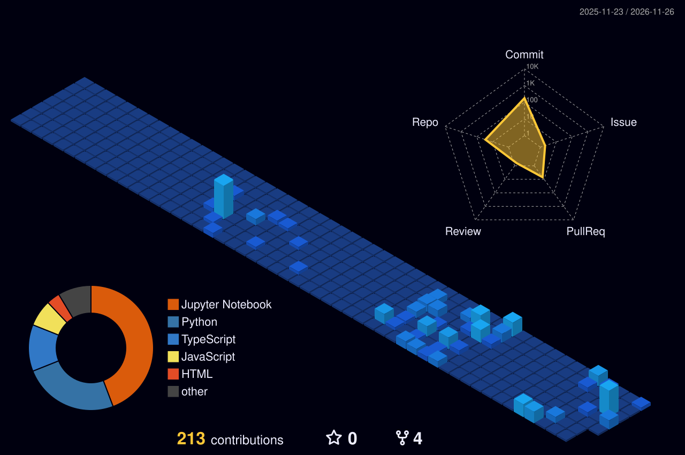

<div align="center">

<!-- 🌊 ANIMATED HEADER BANNER -->


<!-- ⌨️ TYPING ANIMATION -->
<a href="https://git.io/typing-svg">
  
</a>

<br/>

<!-- 🏷️ DYNAMIC BADGES -->
[](https://github.com/muhammadali382)
[](https://github.com/muhammadali382)
[](https://github.com/muhammadali382)


</div>

---

<!-- ═══════════════════════════════════════════════════════════════ -->
<!-- 🧠  ABOUT ME                                                    -->
<!-- ═══════════════════════════════════════════════════════════════ -->

## 🧠 About Me

```python
#!/usr/bin/env python3
# -*- coding: utf-8 -*-

class MuhammadAli:
    """AI Engineer & Full-Stack Developer"""

    name        = "Muhammad Ali"
    username    = "muhammadali382"
    location    = "🌍 Pakistan"
    email       = "muhammadali.aiml92@gmail.com"

    focus = [
        "🤖 Agentic AI (RAG, LangGraph, Multi-Agent Systems)",
        "🌐 Full-Stack Development (MERN)",
        "📱 Cross-Platform Mobile (Flutter)",
        "⚙️ Workflow Automation (n8n)",
        "🔌 Model Context Protocol (MCP) Servers",
    ]

    currently   = "Building production-ready Agentic AI pipelines"
    learning    = "Advanced LangGraph orchestration & multi-agent workflows"
    achievement = "🦈 Pull Shark"
    ask_me     = ["AI Agents", "RAG systems", "MERN", "Flutter", "n8n"]
    fun_fact   = "I trained an AI to debate. It now questions my life choices. 😅"

    @staticmethod
    def reach_me():
        return {
            "github" : "https://github.com/muhammadali382",
            "email"  : "muhammadali.aiml92@gmail.com",
            "linkedin": "https://linkedin.com/in/muhammadali382",
        }
```

---

<!-- ═══════════════════════════════════════════════════════════════ -->
<!-- 🛠️  TECH STACK                                                  -->
<!-- ═══════════════════════════════════════════════════════════════ -->

## 🛠️ Tech Stack

### 🤖 Agentic AI & Machine Learning
<p>
  
  
  
  
  
  
  
  
</p>

### 🌐 Full-Stack (MERN)
<p>
  
  
  
  
  
  
  
</p>

### 📱 Mobile
<p>
  
  
</p>

### ⚙️ Automation & DevOps
<p>
  
  
  
</p>

### 🛠️ Languages & Core Tools
<p>
  
  
  
  
  
  
</p>

---

<!-- ═══════════════════════════════════════════════════════════════ -->
<!-- 🌟  FEATURED PROJECTS                                           -->
<!-- ═══════════════════════════════════════════════════════════════ -->

## 🌟 Featured Projects

<div align="center">

| 🚀 Project | 📋 Description | 🏷️ Tech |
|:----------|:--------------|:--------|
| 🏥 [**tabeeb-care**](https://github.com/muhammadali382/tabeeb-care) | AI-powered healthcare assistant — built at a hackathon | TypeScript · AI · Healthcare |
| 🧠 [**neural-debate**](https://github.com/muhammadali382/neural-debate) | Multi-agent AI debate engine — Hacktoberfest project | Python · LangGraph · Multi-Agent |
| 💬 [**groq-chatbot**](https://github.com/muhammadali382/groq-chatbot) | RAG-powered chatbot using Groq + LangChain + LangGraph | Python · LangChain · RAG |
| 🔌 [**Chatbot-MCP-Server**](https://github.com/muhammadali382/Chatbot-MCP-Server) | Custom MCP servers powering AI agents | Python · MCP · Agentic AI |
| 🎙️ [**Jarvis-Mini**](https://github.com/muhammadali382/Jarvis-Mini---Python-Project) | Python voice assistant with wake-word + speech recognition | Python · Jupyter · NLP |

</div>

---

<!-- ═══════════════════════════════════════════════════════════════ -->
<!-- 📊  GITHUB STATS                                               -->
<!-- ═══════════════════════════════════════════════════════════════ -->

## 📊 GitHub Stats

<div align="center">


</div>

<div align="center">


</div>

---

<!-- ═══════════════════════════════════════════════════════════════ -->
<!-- 🏆  TROPHIES                                                    -->
<!-- ═══════════════════════════════════════════════════════════════ -->

## 🏆 GitHub Trophies

<div align="center">
  
</div>

---

<!-- ═══════════════════════════════════════════════════════════════ -->
<!-- 🐍  SNAKE CONTRIBUTION ANIMATION (auto-generated via Actions)  -->
<!-- ═══════════════════════════════════════════════════════════════ -->

## 🐍 Contribution Snake

<div align="center">
  <picture>
    <source media="(prefers-color-scheme: dark)" srcset="https://raw.githubusercontent.com/muhammadali382/muhammadali382/output/github-snake-dark.svg"/>
    <source media="(prefers-color-scheme: light)" srcset="https://raw.githubusercontent.com/muhammadali382/muhammadali382/output/github-snake.svg"/>
    
  </picture>
</div>

---

<!-- ═══════════════════════════════════════════════════════════════ -->
<!-- 🧊  3D CONTRIBUTION CHART (auto-generated via Actions)         -->
<!-- ═══════════════════════════════════════════════════════════════ -->

## 🧊 3D Contribution Chart

<div align="center">
  <picture>
    <source media="(prefers-color-scheme: dark)"  srcset="./profile-3d-contrib/profile-night-view.svg"/>
    <source media="(prefers-color-scheme: light)" srcset="./profile-3d-contrib/profile-green.svg"/>
    
  </picture>
</div>

---

<!-- ═══════════════════════════════════════════════════════════════ -->
<!-- 📈  ACTIVITY GRAPH                                             -->
<!-- ═══════════════════════════════════════════════════════════════ -->

## 📈 Contribution Graph

<div align="center">
  
</div>

---

<!-- ═══════════════════════════════════════════════════════════════ -->
<!-- 📊  METRICS (auto-generated via Actions)                       -->
<!-- ═══════════════════════════════════════════════════════════════ -->

## 📊 Detailed Metrics

<div align="center">
<table>
  <tr>
    <td>
      
    </td>
    <td>
      
    </td>
  </tr>
</table>
</div>

---

<!-- ═══════════════════════════════════════════════════════════════ -->
<!-- 🎯  CURRENT FOCUS                                              -->
<!-- ═══════════════════════════════════════════════════════════════ -->

## 🎯 Current Focus

<table>
  <tr>
    <td>🔭 <b>Building</b></td>
    <td>Production-ready Agentic AI pipelines with LangGraph</td>
  </tr>
  <tr>
    <td>🌱 <b>Learning</b></td>
    <td>Advanced multi-agent orchestration & MCP ecosystem</td>
  </tr>
  <tr>
    <td>🤝 <b>Open to</b></td>
    <td>Collaborating on AI, Full-Stack, or Automation projects</td>
  </tr>
  <tr>
    <td>💬 <b>Ask me about</b></td>
    <td>RAG systems · LangGraph · MERN · Flutter · n8n</td>
  </tr>
  <tr>
    <td>⚡ <b>Fun fact</b></td>
    <td>I built a voice AI named Jarvis. It now ignores me. 🤷</td>
  </tr>
</table>

---

<!-- ═══════════════════════════════════════════════════════════════ -->
<!-- 💡  DEV QUOTE                                                   -->
<!-- ═══════════════════════════════════════════════════════════════ -->

## 💡 Dev Quote of the Day

<div align="center">
  
</div>

---

<!-- ═══════════════════════════════════════════════════════════════ -->
<!-- 🤝  CONNECT                                                     -->
<!-- ═══════════════════════════════════════════════════════════════ -->

## 🤝 Let's Connect

<div align="center">

[](https://github.com/muhammadali382)
[](https://www.linkedin.com/in/muhammadali382)
[](mailto:muhammadali.aiml92@gmail.com)

<br/>

> 💬 *"I'm always open to interesting conversations and collaboration opportunities!"*

</div>

---

<!-- 🌊 FOOTER WAVE -->
<div align="center">
  

  **"Building AI that works. Shipping code that matters."** 🚀

  *⭐ Found something useful? Star the repo — it really means a lot!*

</div>
